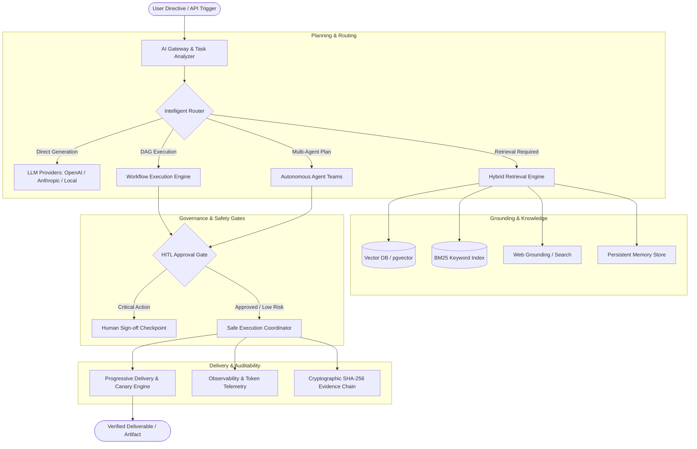

# LLM Work Orchestration Layer (AI Work Layer)

[](package.json)
[](https://nextjs.org/)
[](https://fastapi.tiangolo.com/)
[](https://www.python.org/)
[](https://www.postgresql.org/)
[](https://tailwindcss.com/)
[](https://docs.pytest.org/)
[](LICENSE)

> **"One enterprise platform for orchestrating real, mission-critical work with Large Language Models."**

The **LLM Work Orchestration Layer** is a provider-agnostic, multi-tenant enterprise operating platform designed to execute complex, multi-step workflows with AI. It seamlessly connects task analysis, dynamic model routing, hybrid retrieval (RAG), autonomous multi-agent teams, human-in-the-loop (HITL) safety gates, progressive delivery, and tamper-evident compliance logging.

---

## 📑 Table of Contents

- [🏛️ System Architecture](#️-system-architecture)
- [✨ Core Capabilities](#-core-capabilities)
  - [1. Multi-Model AI Gateway & Intelligent Routing](#1-multi-model-ai-gateway--intelligent-routing)
  - [2. Context Engine & Hybrid RAG Pipeline](#2-context-engine--hybrid-rag-pipeline)
  - [3. Autonomous Multi-Agent Teams & Workflows](#3-autonomous-multi-agent-teams--workflows)
  - [4. Human-in-the-Loop (HITL) Control Center](#4-human-in-the-loop-hitl-control-center)
  - [5. Solution Builder & Service Catalog](#5-solution-builder--service-catalog)
  - [6. Progressive Delivery & Release Coordination](#6-progressive-delivery--release-coordination)
  - [7. Enterprise Data Governance & Audit Evidence Chain](#7-enterprise-data-governance--audit-evidence-chain)
  - [8. Security Operations Center (SOC) & Incident Containment](#8-security-operations-center-soc--incident-containment)
  - [9. Observability, Telemetry & Cost Intelligence](#9-observability-telemetry--cost-intelligence)
- [📁 Project Structure](#-project-structure)
- [🚀 Getting Started](#-getting-started)
  - [Prerequisites](#prerequisites)
  - [Backend Setup](#backend-setup)
  - [Frontend Setup](#frontend-setup)
- [⚙️ Environment Configuration](#️-environment-configuration)
- [📡 API Reference](#-api-reference)
- [🧪 Testing & Quality Verification](#-testing--quality-verification)
- [🔒 Security & Compliance](#-security--compliance)
- [📄 License](#-license)

---

## 🏛️ System Architecture

The platform is designed around strict separation of concerns, deterministic guardrails, and non-authoritative client principles:



---

## ✨ Core Capabilities

### 1. Multi-Model AI Gateway & Intelligent Routing
- **Provider-Independent Runtime**: Native adapters for OpenAI, Anthropic, Google Gemini, and mock test providers.
- **Dynamic Routing Policies**: Routes tasks automatically based on latency, cost efficiency, context window requirements, or custom policy matrices.
- **Circuit Breaker & Fallbacks**: Integrated circuit breaker (5-strike threshold, 60s cooldown) with automatic capability-preserving failover (`MAX_MODEL_FALLBACKS = 2`).
- **Streaming & Telemetry**: Native Server-Sent Events (SSE) streaming with granular token usage and latency metrics.

### 2. Context Engine & Hybrid RAG Pipeline
- **Intelligent Retrieval Router**: Analyzes instructions to choose optimal strategies: `none`, `keyword` (BM25), `vector` (cosine similarity), `hybrid` (Reciprocal Rank Fusion - RRF), or `multi_query` (query expansion).
- **Multi-Format Extraction**: Ingests and processes `.pdf`, `.docx`, `.md`, and `.txt` documents with structure-aware chunking and token budget enforcement.
- **Untrusted Content Demarcation**: Strict boundary isolation prevents prompt injections from external web search snippets or third-party documents from overriding platform safety directives.
- **Semantic Caching**: In-memory and persistent semantic cache matching queries via cosine distance thresholds to reduce redundant LLM calls.

### 3. Autonomous Multi-Agent Teams & Workflows
- **Specialized Agent Teams**: Composes autonomous agents into coordinated squads with defined roles, specialized system prompts, and scoped permissions.
- **Deterministic & Hybrid Planners**: Supports fully deterministic execution plans, LLM-generated plans, and hybrid planner repair loops.
- **DAG Workflow Engine**: Supports multi-step Directed Acyclic Graph (DAG) pipelines featuring conditional branching, parallel fan-out, parameter passing, and state checkpointing.
- **Durable Job System**: Background workers with distributed leases, heartbeats, and automatic retry policies.

### 4. Human-in-the-Loop (HITL) Control Center
- **Fundamental Safety Invariant**: *"The model can propose an action, but it can never authorize its own action."*
- **Deterministic Risk Scoring**: Evaluates action payloads into `low`, `medium`, `high`, or `critical` risk tiers.
- **Mandatory Approval Gates**: Destructive operations (database writes, connector modifications, production rollouts) pause workflow state (`waiting_for_approval`) until authenticated human sign-off.
- **Edit-Before-Execute**: Approvers can inspect, modify, and authorize amended payloads before execution resumes.

### 5. Solution Builder & Service Catalog
- **Service Catalog**: Discover and publish reusable organizational capabilities across Connectors, Agent Teams, and Workflows.
- **Visual Solution Studio**: Interactive builder allowing teams to compose multi-agent solutions, map component input/output ports, and run synthetic validation checks.
- **Dependency Tree & Manifests**: Automatically traces and exports full dependency trees linking solutions down to specific foundational tools, models, and credentials.

### 6. Progressive Delivery & Release Coordination
- **Canary & Percentage Rollouts**: Automated release cutovers with configurable stage percentages (e.g., 5% -> 25% -> 100%).
- **Freeze Windows & Locks**: Prevents risky production deployments during organizational freeze periods or active release windows.
- **Automated Rollback Engine**: Monitors live health metrics and regression gates during deployment, automatically halting rollouts and rerouting traffic on error anomalies.

### 7. Enterprise Data Governance & Audit Evidence Chain
- **Tamper-Evident Evidence Logging**: Every governance decision and critical execution is cryptographically linked via SHA-256 hash chaining (`ComplianceEvidence`).
- **Data Classification & Privacy Workflows**: Enforces classification labels (`public`, `internal`, `confidential`, `restricted`) with built-in GDPR/CCPA data export and erasure routines.
- **Protective Legal Holds**: Locks covered assets from deletion or lifecycle retention purges during legal discovery.

### 8. Security Operations Center (SOC) & Incident Containment
- **Signal Aggregation & Correlation**: Ingests and correlates security signals into structured incident timelines.
- **Automated Containment Playbooks**: Quarantines compromised tokens, revokes workspace credentials, and isolates affected agent runtimes without manual intervention.
- **Autonomous Reliability Assurance**: Continual system self-checks monitoring configuration drift and unauthorized access patterns.

### 9. Observability, Telemetry & Cost Intelligence
- **Full Execution Tracing**: Chronological event streams tracking every planning step, tool call, retrieval query, and generation.
- **Granular Token Accounting**: Accurate cost and token tracking across input, output, and cached tokens.
- **Replay & Debugging Studio**: Time-travel execution replay allowing developers to inspect snapshots, step through historical runs, and run side-by-side comparative analyses.

---

## 📁 Project Structure

```
├── backend/
│   ├── alembic/                      # Database migration versions
│   ├── app/
│   │   ├── api/                      # REST API routes and dependencies
│   │   │   ├── endpoints/            # Changes, releases, rollouts, coordination
│   │   │   └── routes/               # Tasks, agents, runs, workflows, auth, governance
│   │   ├── core/                     # Auth, configuration, logging, and error handlers
│   │   ├── db/                       # SQLAlchemy declarative models and database engine
│   │   ├── repositories/             # Data access layer and multi-tenant queries
│   │   ├── schemas/                  # Pydantic request/response contracts
│   │   └── services/                 # Core domain service implementations
│   │       ├── ai_gateway/           # Multi-model gateway, fallbacks, circuit breaker
│   │       ├── context/              # Context engine, prompt formatting, token budgeting
│   │       ├── data_governance/      # Evidence chaining, privacy, legal holds
│   │       ├── hitl/                 # Human-in-the-loop intervention management
│   │       ├── progressive_delivery/ # Canary controller, stages, and health gates
│   │       ├── releases/             # Release builder, locks, freeze windows, executor
│   │       ├── security/             # Signal correlation, containment, and playbooks
│   │       └── task_intelligence/    # Complexity analyzer and execution requirements
│   ├── requirements.txt              # Python production dependencies
│   └── tests/                        # 909 comprehensive unit and integration tests
├── src/
│   ├── app/                          # Next.js 15 App Router pages & layouts
│   │   ├── app/                      # Primary application suite (152 interactive routes)
│   │   │   ├── agents/               # Autonomous agent management
│   │   │   ├── ai-runtime/           # AI Gateway dashboard & routing inspector
│   │   │   ├── approvals/            # HITL intervention dashboard
│   │   │   ├── catalog/              # Service catalog & capability directory
│   │   │   ├── contracts/            # Capability SLAs & breach detection
│   │   │   ├── data-governance/      # Evidence audit trails & privacy requests
│   │   │   ├── intent/               # Intent synthesis & requirement parsing
│   │   │   ├── releases/             # Release coordination & production gates
│   │   │   ├── rollouts/             # Live canary rollout monitors
│   │   │   ├── solutions/            # Visual Solution Studio & topology builder
│   │   │   ├── tasks/                # Task runner, streaming output & execution details
│   │   │   └── workflows/            # Workflow DAG builder and run logs
│   │   ├── api/                      # Next.js server route handlers
│   │   └── security/                 # Autonomous security mission control centers
│   ├── components/                   # Reusable UI component library (Tailwind CSS 4)
│   └── lib/                          # Client utilities and security runtime modules
├── package.json                      # Next.js & JavaScript dependencies
└── README.md                         # Platform documentation
```

---

## 🚀 Getting Started

### Prerequisites

Ensure you have the following installed on your machine:
- **Python**: Version `3.12` or later
- **Node.js**: Version `20.x` or later (with `npm`)
- **Git**

---

### Backend Setup

1. **Navigate to the backend directory and set up a virtual environment**:
   ```bash
   cd backend
   python -m venv venv
   
   # On macOS/Linux:
   source venv/bin/activate
   
   # On Windows (PowerShell):
   .\venv\Scripts\Activate.ps1
   ```

2. **Install dependencies**:
   ```bash
   pip install -r requirements.txt
   ```

3. **Configure Environment Variables**:
   Copy `.env.example` (or create a `.env` in `backend/` or project root):
   ```bash
   cp .env.example .env
   ```

4. **Initialize Database Migrations**:
   The backend defaults to an asynchronous SQLite database for local development, or PostgreSQL for production:
   ```bash
   alembic upgrade head
   ```

5. **Start the FastAPI Backend**:
   ```bash
   python -m uvicorn backend.app.main:app --host 0.0.0.0 --port 8000 --reload
   ```
   - **API Docs (Swagger UI)**: `http://localhost:8000/docs`
   - **OpenAPI Schema**: `http://localhost:8000/openapi.json`
   - **Health Check**: `http://localhost:8000/api/health`

---

### Frontend Setup

1. **Navigate to the project root and install Node dependencies**:
   ```bash
   npm install
   ```

2. **Run the Next.js development server**:
   ```bash
   npm run dev
   ```
   Open `http://localhost:3000` in your browser.

3. **Build for Production**:
   ```bash
   npm run build
   npm run start
   ```

---

## ⚙️ Environment Configuration

| Variable | Type | Default | Description |
| :--- | :--- | :--- | :--- |
| `ENVIRONMENT` | string | `development` | Runtime environment (`development`, `staging`, `production`) |
| `PORT` | int | `8000` | Backend API port |
| `DATABASE_URL` | string | `sqlite+aiosqlite:///./ai_work_layer.db` | PostgreSQL or SQLite connection string |
| `OPENAI_API_KEY` | string | `None` | OpenAI API key (optional for local/mock testing) |
| `OPENAI_DEFAULT_MODEL`| string | `gpt-4o-mini` | Default generation model |
| `PLANNER_DEFAULT_MODE`| string | `hybrid` | Planning mode (`deterministic`, `llm`, `hybrid`, `auto`) |
| `EVALUATION_DEFAULT_MODE`| string | `standard` | Verification level (`off`, `basic`, `standard`, `strict`) |
| `WEB_SEARCH_PROVIDER` | string | `duckduckgo` | Web grounding provider (`duckduckgo`, `tavily`, `serper`, `mock`) |
| `DOCUMENT_STORAGE_PATH`| string | `.storage/documents` | Storage directory for ingested RAG documents |
| `SUPABASE_JWT_SECRET` | string | `dev-secret...` | JWT secret for tenant token decoding |
| `CORS_ORIGINS` | list | `["http://localhost:3000"]` | Allowed frontend origins |

---

## 📡 API Reference

The backend provides over 80 RESTful endpoints organized by domain:

| Domain | Route Prefix | Primary Operations |
| :--- | :--- | :--- |
| **Authentication & Users** | `/api/auth` | Profile resolution, default workspace provisioning |
| **Workspaces & Tenancy** | `/api/workspaces` | Workspace CRUD, member roles, organizational isolation |
| **Tasks & Execution** | `/api/tasks` | Create tasks, trigger runs (`/run`), SSE live streaming (`/run/stream`) |
| **Runs & Observability** | `/api/runs` | Inspect execution status, token usage (`/usage`), step traces (`/trace`), telemetry |
| **AI Gateway & Models** | `/api/models`, `/api/gateway` | Available model matrix, routing rules, live gateway test execution |
| **Agent Teams** | `/api/agents`, `/api/agent-teams` | Agent lifecycle, team squads, prompt engineering, version control |
| **Workflows** | `/api/workflows` | Workflow DAG definitions, run history, step pause/resume |
| **Human Approvals** | `/api/hitl` | Pending interventions, decision sign-offs, edit-before-execute |
| **Service Catalog** | `/api/catalog`, `/api/contracts` | Capability registration, SLA contract management, breach inspection |
| **Solutions Studio** | `/api/solutions` | Multi-agent solution specifications, dependencies, simulations |
| **Releases & Delivery** | `/api/releases`, `/api/rollouts` | Release promotion, lock management, canary stage advancement, rollbacks |
| **Data Governance** | `/api/data-governance` | Tamper-evident evidence chain verification, privacy erasure, legal holds |
| **Security Operations** | `/api/security` | Ingest signals, incident correlation, automated containment playbooks |

*Interactive Swagger documentation with complete request/response schemas is available at `/docs`.*

---

## 🧪 Testing & Quality Verification

The platform maintains an exhaustive test suite with zero tolerance for regressions:

```bash
# Run the complete test suite across all 909 tests
python -m pytest backend/tests/ -q

# Run specific functional suites
python -m pytest backend/tests/test_task_execution.py -vv
python -m pytest backend/tests/test_ai_gateway.py -vv
python -m pytest backend/tests/test_governance.py -vv
python -m pytest backend/tests/test_observability.py -vv

# Verify frontend code quality and production build
npm run lint
npm run build
```

---

## 🔒 Security & Compliance

- **Zero Hardcoded Credentials**: API keys, JWT secrets, and connector tokens are strictly managed through environment variables and encrypted storage.
- **Cryptographic Evidence Hashing**: Every critical system transition computes an immutable SHA-256 hash linked to the previous state, preventing unauthorized history alterations.
- **Multi-Tenant Data Isolation**: Database queries strictly filter across `organization_id`, `workspace_id`, and `user_id`.
- **Non-Authoritative Frontend**: UI elements cannot bypass backend security policies; all authorization, rate limits, and risk classifications are strictly verified on the server.
- **Pipeline-Free Codebase**: Clean, independent repository structure without external CI/CD pipeline triggers.

---

## 📄 License

This project is licensed under the MIT License - see the [LICENSE](LICENSE) file for details.
