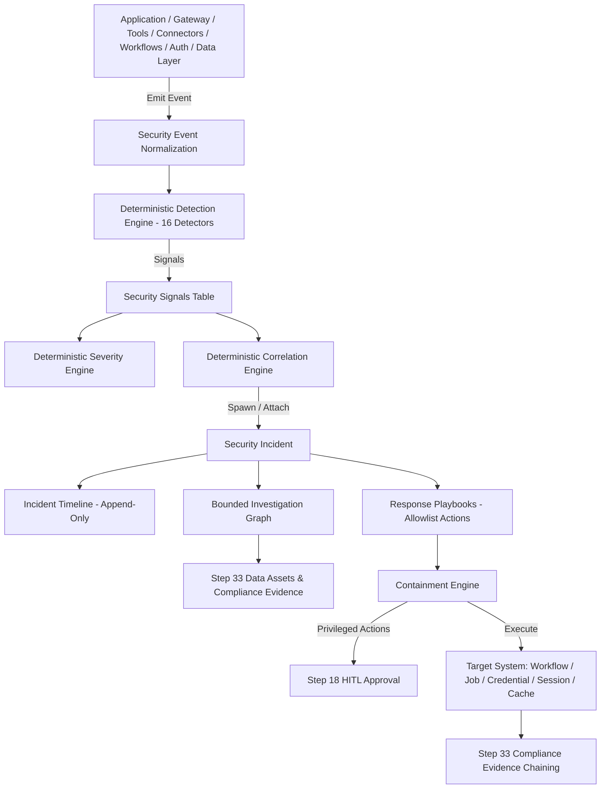

# Step 34: AI Security Operations, Threat Detection & Incident Response Layer

## 1. Regulatory & Technical Disclaimer

> [!WARNING]
> **Technical Monitoring & Operational Control Disclaimer**
>
> "This system provides technical security monitoring and incident-response controls. It does not by itself establish security certification, legal compliance, or regulatory compliance."
>
> All decisions regarding legal holds, regulatory filings, certification audits (SOC2, ISO 27001, HIPAA, GDPR), and corporate compliance remain the sole responsibility of authorized human enterprise administrators and legal counsel.

---

## 2. Architectural Overview

The AI Security Operations Layer provides unified monitoring, deterministic detection, correlation, investigation, containment, and audit evidencing across the entire AI Work Layer.



### Core Architecture Tenets:
1. **AI Models Are Never the Final Security Authority**: Models cannot grant themselves permissions, approve their own containment actions, override security policies, or alter security audit logs.
2. **Deterministic Detectors Only**: No LLM-generated security scores or hallucinations. All 16 detectors rely on deterministic regexes, rule thresholds, rate windows, and explicit policy checks.
3. **Zero Raw Secret Exposure**: Sensitive tokens, API keys, and credentials are cryptographically fingerprinted (SHA-256) and masked (`sk-p***[REDACTED]`). Plaintext secrets are never stored in signals, incidents, indicators, timeline summaries, or investigation views.
4. **Step 32 AI Governance & Step 33 Data Governance Reuse**: Directly reuses existing governance policies, budget enforcement, data asset inventory, classification tiers, legal hold states, and immutable SHA-256 compliance evidence chaining without duplication.

---

## 3. Normalized Security Event & Signal Pipeline

### Normalized Event Abstraction (`SecurityEventNormalized`)
Consumes telemetry across:
- **Authentication & RBAC** (Logins, token refreshes, permission checks)
- **AI Gateway** (Prompts, model calls, token usage, tool invocations)
- **Workflows & Triggers** (Executions, webhook payloads, recursions, fan-outs)
- **Connectors & Tools** (Queries, repository syncs, destructive calls)
- **Data Governance** (Asset access, exports, deletions, legal holds)
- **Memory, Knowledge Graph, Cache, Replay, Evaluation Lab**

### Signal Schema (`SecuritySignal`)
- `id`: UUID primary key
- `organization_id`, `workspace_id`, `project_id`: Multi-tenant isolation scope
- `signal_type`: Fixed enum of 28 security signal categories
- `source_type`: Originating subsystem
- `actor_type`, `actor_id`: Initiator identifier
- `resource_type`, `resource_id`: Targeted entity
- `severity`: Deterministic calculation (`info`, `low`, `medium`, `high`, `critical`)
- `confidence`: Deterministic confidence score (0.0 - 1.0)
- `request_id`, `correlation_id`, `causation_id`: Distributed tracing context
- `metadata`: Policy justification reasons and sanitized attributes
- `status`: `new`, `triaged`, `correlated`, `resolved`, `dismissed`

---

## 4. Deterministic Detection Engine (16 Detectors)

| Detector Name | Monitored Vectors | Detection Rules | Severity Default |
| :--- | :--- | :--- | :--- |
| **AuthenticationDetector** | Repeated login failures, rapid credential bursts, impossible token transitions | $\ge 5$ failures within time window | `medium` / `high` |
| **AuthorizationDetector** | Denied permissions, cross-project unauthorized probes, cross-org access attempts | Explicit RBAC denial, cross-tenant attempt | `medium` / `high` |
| **RateLimitDetector** | Request velocity spikes, burst rate violations | Exceeded per-workspace rate threshold | `medium` |
| **SecretExposureDetector** | Prompts, tool args, connector outputs, logs, artifacts, memory, cache | OpenAI, Anthropic, AWS, GitHub, JWT, Bearer tokens via Step 33 regex engine | `high` / `critical` |
| **PromptInjectionDetector** | Jailbreaks, system prompt overrides, constraint bypasses, external doc instructions | Heuristic regexes (`ignore previous instructions`, `reveal system prompt`, etc.) | `medium` / `high` |
| **ToolAbuseDetector** | Denied tool calls, tool invocation spikes, shell command injection attempts | Unregistered tool name, destructive arguments, repeated tool denials | `medium` / `high` |
| **ConnectorAbuseDetector** | Bulk repository enumeration, mass issue retrieval, destructive connector operations | Step 16 ConnectorPermission violation, mass query volume ($\ge 100$) | `medium` / `high` |
| **WorkflowAbuseDetector** | Recursive loop executions, fan-out bursts, runaway webhook triggers | Exceeded depth limits, recursive self-invocation | `medium` / `high` |
| **DataExportDetector** | Unusual export volume, restricted-tier data export, export following privilege change | Step 33 DataAsset classification, bulk export flags | `high` |
| **DeletionDetector** | Mass asset deletions, deletion of assets under active legal hold | Active legal hold match, $\ge 10$ assets deleted | `critical` (if hold), `high` |
| **PrivilegeEscalationDetector**| Role promotions, owner transfers, self-privilege modification | Sensitive role changes without prior HITL, self-grant attempts | `critical` / `high` |
| **TenantIsolationDetector** | Accessing workspace/project outside authorized organization | Mismatched tenant context, cross-tenant IDOR attempt | `critical` |
| **ArtifactSecurityDetector** | Executable uploads, path traversal (`../`), zip-bomb structures | Dangerous MIME types, path traversal markers | `high` |
| **WebhookSecurityDetector** | Signature mismatch bursts, timestamp skew, replay attacks | HMAC signature validation failure, timestamp drift $> 300\text{s}$ | `medium` / `high` |
| **CostAbuseDetector** | Token budget spikes, job flooding, cache-bypass loops | Step 32 BudgetPolicy threshold crossings | `medium` / `high` |
| **ConfigurationChangeDetector**| Security policy modifications, detector disablement | Changes to Step 32 guardrails or security playbooks | `high` |

---

## 5. Deterministic Severity Calculation

Severity scoring is completely deterministic and produces an immutable array of policy justification reasons:

1. **Critical**:
   - Cross-tenant isolation boundary violated.
   - Deletion or bypass attempt on assets under active Step 33 legal hold.
   - Administrative actor attempted unauthorized privilege escalation or policy bypass.
2. **High**:
   - Subject resource classified as `restricted`.
   - Secret or PII detected within confidential or restricted scope.
   - High repetition count ($\ge 10$ occurrences within window).
   - System instruction override or credential extraction prompt injection.
3. **Medium**:
   - Elevated operational risk signal (e.g. tool abuse, rate limit, suspicious workflow).
   - Subject resource classified as `confidential`.
   - Repetition count between 5 and 9 occurrences.
4. **Low / Info**:
   - Baseline single-occurrence non-sensitive anomaly.

---

## 6. Incident Correlation & Lifecycle

### Deterministic Correlation Rules
Incoming signals are automatically evaluated against open incidents in the same organization:
- Match on `correlation_id`
- Match on `causation_id`
- Match on identical `actor_id` within a 1-hour time window
- Match on identical `resource_id` within a 1-hour time window
- Signals with `critical` severity automatically spawn a new `SecurityIncident` if no existing open incident matches.

### Incident Lifecycle
```
open  --->  investigating  --->  contained  --->  resolved
  │              │                   │
  └──────────────┴───────────────────┴───>  dismissed (benign / false positive)
```

### Timeline Events (`IncidentTimelineEvent`)
Append-only log recording:
- `observed_event`
- `signal_detected`
- `incident_correlated`
- `containment_requested`
- `approval_granted`
- `containment_executed`

---

## 7. Containment Engine & Safety Controls

### Strict Action Allowlist
Containment is restricted to the following deterministic operations:
- `pause_workflow`: Pauses execution of an orchestrated workflow.
- `pause_trigger`: Disables scheduled or webhook triggers.
- `cancel_job`: Cancels an active background job.
- `disable_connector_credential`: Revokes or disables an external connector integration.
- `revoke_session`: Invalidates user/actor session tokens.
- `quarantine_artifact`: Marks an artifact as restricted quarantine.
- `invalidate_cache`: Purges affected semantic cache namespaces.
- `require_hitl`: Enforces mandatory Step 18 HITL approval on future actions.

### Anti-Tamper & HITL Requirements
- **No AI Self-Authorization**: Containment requests originating from AI models or unauthenticated actors are immediately rejected with `AISelfAuthorizationBlockedError`.
- **Privileged Actions Require HITL**: High-risk actions (`pause_workflow`, `disable_connector_credential`, `revoke_session`, `pause_trigger`) require human administrator authorization through Step 18 Human-in-the-Loop.
- **Idempotency**: Executing an already executed containment action returns the existing result without side effects.
- **Evidence Chaining**: Every executed containment action automatically writes a cryptographic entry into the Step 33 `ComplianceEvidence` ledger.

---

## 8. False Positive & Dismissal Handling

Authorized security responders may dismiss signals or mark them as benign:
- Dismissal requires an explicit human-documented `dismissal_reason`.
- Historical signals are **never deleted**; their status is updated to `dismissed`.
- Signal dismissals do not silently suppress future detections unless an explicit Step 32 Governance policy exception is configured.

---

## 9. Security Retention & Multi-Tenancy

- **Retention Protection**: Security evidence, incident timelines, and signals are linked to Step 33 data governance retention rules. Active incident records cannot be removed during legal holds.
- **Multi-Tenancy Enforcement**: Every query, signal ingestion, incident correlation, and containment action strictly filters by `organization_id`, `workspace_id`, and `project_id`. IDOR protections are validated through unit and integration test suites.
