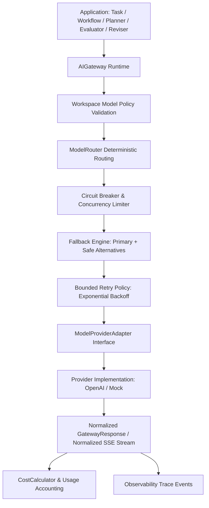

# AI Gateway Architecture & Unified Runtime

## 1. Overview & Core Philosophy

The AI Gateway provides one unified, production-grade runtime for all model executions across the AI Work Layer platform—including tasks, workflows, planning, evaluation, and revision.

> **Fundamental Invariant:**  
> **"No application component calls provider SDKs directly. All model invocations flow through the AI Gateway runtime to guarantee policy enforcement, deterministic routing, resilience fallbacks, circuit breaking, bounded concurrency, and accurate cost tracking."**

The gateway is strictly **provider-independent** and **free of subjective model rankings**. Routing is governed by hard capability requirements, objective context window sizes, cost classes, latency classes, and workspace governance policies.

---

## 2. High-Level Architecture Flow



---

## 3. Normalized Request & Response Contracts

### 3.1 `GatewayRequest`
All callers supply the normalized contract:
- `model`: Target model identifier or `"auto"`.
- `provider`: Optional provider hint or constraint.
- `messages`: Normalized list of chat messages (`role`, `content`).
- `system_instruction`: Optional system prompt.
- `temperature`: Bounded sampling parameter (0.0 – 2.0).
- `max_tokens`: Maximum tokens to generate.
- `stream`: Boolean indicating real-time streaming.
- `tools`: Optional tool/function declarations.
- `response_format`: Optional structured output format (e.g. `{"type": "json_object"}`).
- `metadata`: Operational trace identifiers (`run_id`, `task_id`, `workflow_id`).
- `workspace_id`: Tenant boundary for policy enforcement.

Safe deterministic fingerprinting (`get_fingerprint()`) hashes request metadata and message shapes without storing or exposing sensitive raw prompt contents.

### 3.2 `GatewayResponse`
Normalized response returned to all application features:
- `request_id`: UUID tracking the gateway call.
- `provider`: Resolved provider identifier.
- `model`: Resolved model identifier.
- `content`: Generated text content.
- `finish_reason`: Termination reason (`stop`, `length`, etc.).
- `usage`: `GatewayUsage` containing `input_tokens`, `output_tokens`, `total_tokens`, `usage_source`, and `estimated_cost` in USD.
- `latency_ms`: Round-trip execution latency.
- `metadata`: Operational trace and adapter information.

### 3.3 Normalized Streaming
Streaming emits unified Server-Sent Events (SSE):
- `delta`: `{"type": "delta", "content": "..."}`
- `usage`: `{"type": "usage", "usage": {...}, "estimated_cost": ...}`
- `model_fallback`: `{"type": "model_fallback", "from_model": "...", "to_model": "...", ...}`
- `completed`: `{"type": "completed", "finish_reason": "stop"}`
- `error`: `{"type": "error", "error": {...}}`

---

## 4. Provider Adapter Interface

Vendor-specific SDK calls and protocols are isolated behind the `ModelProviderAdapter` interface:

```python
class ModelProviderAdapter(ABC):
    @property
    def provider_id(self) -> str: ...
    @property
    def provider_name(self) -> str: ...
    @property
    def is_configured(self) -> bool: ...

    async def generate(self, request: GatewayRequest) -> GatewayResponse: ...
    async def generate_stream(self, request: GatewayRequest) -> AsyncIterator[Dict[str, Any]]: ...
    def validate_model(self, model: str) -> bool: ...
    def get_capabilities(self, model: str) -> List[str]: ...
    def normalize_usage(self, raw_usage: Any) -> GatewayUsage: ...
    async def health_check(self) -> Dict[str, Any]: ...
```

Built-in adapters:
- **`OpenAIAdapter`**: Official AsyncOpenAI SDK.
- **`MockAdapter`**: Deterministic offline mock engine for unit testing and local development.
- **`BaseProviderAdapter`**: Wraps any legacy `BaseLLMProvider` so existing and test-mock providers work automatically.

---

## 5. Centralized Model Routing

The AI Gateway delegates selection to the existing `ModelRouter`:
- **Manual Selection**: Validates requested model against registered capabilities and workspace policy.
- **Automatic Routing**: Scores eligible models using objective capability satisfaction, context headroom, latency classes, and cost classes.
- Generates ordered **fallback candidates** prioritizing cross-provider resilience without downgrading required capabilities.

---

## 6. Resilience: Fallbacks, Retries & Circuit Breaking

### 6.1 Fallback Engine
- Sequentially tries up to `MAX_MODEL_FALLBACKS = 2` alternative candidates.
- **Eligible Failures**: Rate limits (429), timeouts (504), network errors, provider outages (503).
- **Ineligible Failures (Never Fallback)**: Policy violations (`PolicyDeniedError`), invalid requests (`InvalidRequestError`), capability mismatches.
- **Capability Safety**: Verifies fallback candidates support all hard constraints (tools, streaming, JSON schema, vision) before execution.

### 6.2 Bounded Retries
- Bounded to `MAX_MODEL_RETRIES = 2`.
- Exponential backoff: `0.25s * (2 ^ (attempt - 1))`.
- Only transient network and rate-limit errors are retried.

### 6.3 Circuit Breaker
- In-memory circuit breaker (`closed`, `open`, `half_open`).
- Opens circuit after 5 consecutive failures on a provider/model target (`CIRCUIT_FAILURE_THRESHOLD = 5`).
- Enforces a 60-second cooldown period (`CIRCUIT_RESET_SECONDS = 60`) before transitioning to `half_open` for recovery probing.

---

## 7. Concurrency & Policy Boundaries

### 7.1 Concurrency Limits
- Enforces `MAX_CONCURRENT_MODEL_REQUESTS = 10` per workspace using non-blocking acquisition.
- Protects downstream providers from runaway concurrent workflow iterations.

### 7.2 Workspace Model Policy
Database model `WorkspaceModelPolicy`:
- `allowed_providers`: Whitelisted provider IDs.
- `allowed_models`: Whitelisted model IDs (empty = all registered enabled models).
- `default_model`: Workspace default model.
- `max_tokens_per_request`: Hard ceiling on generation tokens.
- `max_requests_per_run`: Bounded model calls per execution run.
- `max_concurrent_requests`: Workspace concurrency cap.
- `fallback_enabled`: Ability to toggle automated fallback switching.

---

## 8. Observability & Cost Integration

### 8.1 Telemetry Events
The gateway records structured events:
- `gateway_request_started`
- `gateway_request_completed`
- `gateway_retry`
- `gateway_fallback`
- `gateway_timeout`
- `gateway_failed`

Metadata logged: `gateway_request_id`, `model`, `provider`, `fallback_attempt`, `retry_count`, `total_tokens`, `estimated_cost`, `latency_ms`.  
**Zero-Secrets Guarantee**: Prompts, credentials, API keys, and internal chain-of-thought are never logged or stored.

### 8.2 Cost Calculator
Reuses `CostCalculator.calculate_generation_cost` matching official 1M-token pricing configurations. If pricing metadata is not available, `estimated_cost` is safely set to `null` (never guessed).

---

## 9. How to Add a New Provider

Adding a new provider requires zero modifications to existing workflows, planners, or task execution engines:

1. Create adapter implementing `ModelProviderAdapter` (or subclassing `BaseProviderAdapter`) in `backend/app/services/ai_gateway/adapters.py`.
2. Register the adapter in `ProviderRegistry`:
   ```python
   registry.register(AnthropicAdapter())
   ```
3. Register the provider's models and capabilities in `backend/app/services/models/catalog.py`.
4. The AI Gateway, ModelRouter, fallback engine, and circuit breaker immediately support the new provider across all tasks and workflows.
