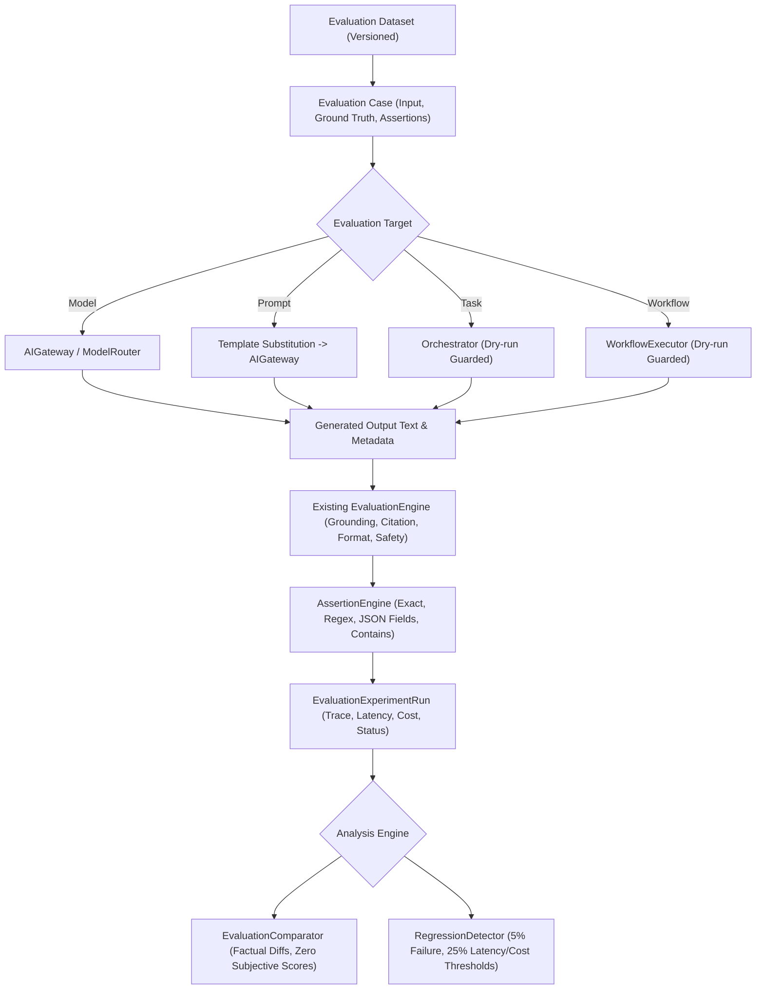

# Step 22: AI Evaluation Lab Architecture

## 1. Overview & Core Mission

The **AI Evaluation Lab** provides a production-grade infrastructure for creating versioned evaluation datasets, defining deterministic assertion suites, executing repeatable experiments against models, prompts, tasks, and workflows, generating factual differential comparisons, and continuously detecting regressions across system iterations.

The system is designed to objectively and reliably answer:
1. > *"Did this change actually improve the AI system?"*
2. > *"Which executions fail, where do they fail, and what changed?"*

---

## 2. End-to-End Pipeline & Architecture Flow

```
Dataset
   ↓
Evaluation Case
   ↓
Target (Model, Prompt, Task, Workflow, Replay Snapshot)
   ↓
Existing Execution Engine (AIGateway, TaskIntelligence, Orchestrator, ModelRouter)
   ↓
Output
   ↓
EvaluationEngine (Grounding, Completeness, Citation, Format, Safety)
   ↓
Assertions (Deterministic Rules)
   ↓
Experiment Result
   ↓
Comparison / Regression Detection
```



---

## 3. Dataset Structure & Immutability

### Dataset Entity (`EvaluationDataset`)
- `id`: UUID (Unique dataset identifier)
- `workspace_id`: Strictly isolated tenant workspace
- `name`: Dataset title
- `description`: Scope and evaluation intent
- `version`: Monotonically increasing version counter
- `status`: Lifecycle state (`draft`, `active`, `archived`)

### Dataset Versions (`EvaluationDatasetVersion`)
- A dataset version references a fixed, frozen set of evaluation cases.
- **Permanent Immutability Rule**: Once an evaluation experiment reaches `completed` referencing a dataset version, that dataset version is **permanently locked**.
- Attempting to add, edit, or delete cases from a locked version raises `DatasetVersionLockedError`.
- Users must create a new version to modify cases, ensuring that past evaluation results remain 100% reproducible over time.

---

## 4. Evaluation Cases & Deterministic Assertions

Each case (`EvaluationCase`) contains:
- `case_key`: Human-readable identifier (e.g. `qa_math_01`, `summarize_long_doc`)
- `name`: Descriptive name
- `input_data`: JSON payload or text prompt
- `expected_output`: Optional gold-standard reference string
- `expected_context` & `expected_sources`: Optional reference retrieval items
- `assertions`: Array of deterministic assertion rules

### Supported Assertion Types

| Assertion Type | Evaluation Method | Safe Execution |
| :--- | :--- | :---: |
| `exact_match` | Text or JSON path equality with normalized whitespace. | ✅ Strict deterministic |
| `contains` | Substring inclusion check in output or JSON path. | ✅ Strict deterministic |
| `not_contains` | Prohibited substring check for disallowed phrases. | ✅ Strict deterministic |
| `regex` | Regular expression pattern matching. | ✅ Strict deterministic |
| `json_fields` | Validates that output parses as valid JSON with required keys. | ✅ Strict deterministic |
| `citation_exists` | Checks for citation markers (e.g. `[source_1]`, `[doc_...]`). | ✅ Strict deterministic |
| `citation_matches_source` | Verifies that cited references exist in context sources. | ✅ Strict deterministic |
| `grounded_claims` | Cross-checks with GroundingEvaluator findings for hallucinations. | ✅ Strict deterministic |
| `required_fields` | Verifies presence of required sections or markdown headers. | ✅ Strict deterministic |
| `output_format` | Validates format structure (`json`, `markdown`, `bullet_points`, `table`). | ✅ Strict deterministic |
| `evaluator_check` | Directly targets an EvaluationEngine check outcome (e.g. `safety`, `completeness`). | ✅ Strict deterministic |

> [!CAUTION]
> **No Arbitrary Code Execution**: Custom script evaluation and dynamic code execution (`eval()`, `exec()`) are strictly forbidden in assertions to prevent remote code execution vectors.

---

## 5. Dataset Import & Export

- **Supported Formats**:
  - `JSON`: Array of case objects or object with a `"cases"` key.
  - `JSONL`: Line-delimited JSON objects.
  - `CSV`: Comma-separated values with `case_key`, `name`, `input`, and optional `expected_output`.
- **Enforced Safety Bounds**:
  - `MAX_EVALUATION_CASES = 10,000`
  - `MAX_CASE_INPUT_BYTES = 100,000` (100KB per case)
  - `MAX_DATASET_BYTES = 50,000,000` (50MB total import payload)
- **Automatic Sanitization**: Imports undergo regex sweeps redacting API keys, Bearer tokens, private keys, database connection strings, and JWTs.

---

## 6. Experiment Lifecycle & Execution Engine

```
Draft → Queued → Running → Completed | Failed | Cancelled
```

1. **Pre-flight Validation**: Before execution, `validate_cases_integrity` verifies that no duplicate keys exist, no empty inputs are present, and every case has at least one assertion or expected output.
2. **Target Dispatching**:
   - `model`: Dispatches to `AIGateway` using model name, provider, and temperature.
   - `prompt`: Performs template substitution (`{input}`) and queries `AIGateway`.
   - `task`: Evaluates task execution rules via `Orchestrator` in dry-run mode.
   - `workflow`: Runs workflow graph in dry-run mode via `WorkflowExecutor`.
   - `replay_snapshot`: Evaluates against historical replay parameters.
3. **Bounded Concurrency**: Managed by `asyncio.Semaphore(MAX_EVALUATION_CONCURRENCY)` (bounded to 5 workers) to avoid overwhelming model provider rate limits.
4. **Cooperative Cancellation**: `POST /api/evaluation/experiments/{id}/cancel` sets an in-memory cancellation token, halts queued cases, marks in-flight cases cancelled, and preserves all completed run records.

---

## 7. Factual A/B Comparison & Regressions

### EvaluationComparator
The comparator contrasts Experiment A and Experiment B without subjective scores:
- **Case Status Divergence**: Flags cases changing between `passed`, `failed`, `warning`, `error`.
- **Assertion Deltas**: Reports exact rules that flipped outcome.
- **Verification Differences**: Compares grounding, completeness, format, and citation findings.
- **Operational Deltas**:
  - Average latency delta (ms)
  - Total token consumption delta
  - Estimated cost delta ($USD)

### RegressionDetector
Evaluates explicit, deterministic regression conditions against baseline:
1. **Case Regressions**: Previously passed case becoming `failed`, `error`, or `warning`.
2. **Evaluator Lost**: Grounding, citation, safety, or format check passed in baseline but failed in candidate.
3. **Threshold Breaches**:
   - `MAX_FAILURE_RATE_INCREASE = 0.05` (5% failure rate increase)
   - `MAX_LATENCY_INCREASE_PERCENT = 25.0` (25% latency increase)
   - `MAX_COST_INCREASE_PERCENT = 25.0` (25% cost increase)

---

## 8. Security & Side-Effect Guarantees

1. **Workspace Isolation**: Datasets, versions, cases, experiments, and comparisons require active membership in the target workspace. Cross-workspace operations are rejected with `404 / 403`.
2. **Side-Effect Isolation**: Mutating tools, external connector writes, and database modifications default to dry-run simulation during evaluation.
3. **Destructive Action Blocking**: Any destructive action attempted during an evaluation experiment is blocked unless explicitly authorized by fresh Human-in-the-Loop (HITL) confirmation. Historical approvals are never reused.
4. **Memory Mutation Safety**: Evaluation runs do not create persistent memory records. Read-only retrieval is permitted if configured.
5. **No Secrets in Datasets**: Secret patterns are redacted with `[REDACTED]` upon import and persistence.
6. **No Subjective Model Rankings**: Neither the comparator nor the dashboard designates a "winner" or "best model". All reports present measurable, empirical facts.
