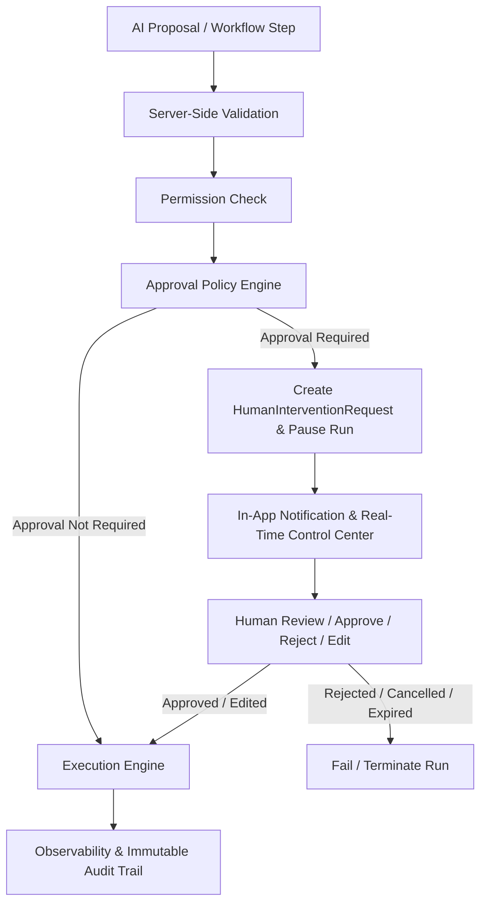

# Human-in-the-Loop (HITL) Architecture & Control Center

## 1. Overview & Core Philosophy

The Human-in-the-Loop (HITL) system provides production-grade oversight, authorization, editing, and pause/resume capabilities for workflow executions and tool/connector actions within the AI Work Layer platform.

> **Fundamental Invariant:**  
> **"The model can propose an action, but it can never authorize its own action."**

Human approval is strictly enforced on the server. Frontend approval buttons and client-side requests are never authoritative. Destructive and unauthorized operations cannot execute under any circumstance without explicit, authenticated, and valid human authorization within the designated workspace boundary.

---

## 2. High-Level Architecture Flow

---

## 3. Core Concepts & Data Models

### 3.1 Data Models
1. **`HumanInterventionRequest`**:
   - Primary entity tracking intervention lifecycle.
   - Fields: `id` (UUID), `workspace_id`, `project_id`, `workflow_id`, `workflow_run_id`, `run_id`, `step_id`, `requested_by`, `assigned_to`, `intervention_type`, `title`, `description`, `status`, `priority`, `requested_action`, `input_snapshot`, `safe_context`, `available_actions`, `selected_action`, `response_data`, `created_at`, `expires_at`, `resolved_at`.
   - Statuses: `pending`, `approved`, `rejected`, `edited`, `expired`, `cancelled`.
   - Types: `approval`, `review`, `edit`, `confirmation`, `authorization`.
   - Priorities: `low`, `normal`, `high`, `critical`.

2. **`ApprovalDecision`**:
   - Transactional record capturing the human decision.
   - Fields: `id`, `intervention_id`, `workspace_id`, `user_id`, `decision` (`approve`, `reject`, `edit`, `cancel`), `comment`, `edited_data`, `created_at`.

3. **`HumanAction` (Immutable Audit Trail)**:
   - Append-only audit record of every human decision and intervention state transition.
   - Fields: `id`, `workspace_id`, `intervention_id`, `user_id`, `action_type`, `target_type`, `target_id`, `metadata`, `created_at`.
   - Guaranteed free of credentials, tokens, or raw secrets.

4. **`WorkspaceApprovalPolicy`**:
   - Workspace-level governance configuration:
     - `require_tool_approval` (bool)
     - `require_connector_write_approval` (bool, default `True`)
     - `require_destructive_approval` (bool, default `True`, non-bypassable)
     - `require_external_action_approval` (bool, default `True`)
     - `require_evaluation_failure_review` (bool, default `True`)
     - `max_auto_cost` (float)

5. **`Notification`**:
   - In-app notification delivered to assignees and workspace operators.
   - Fields: `id`, `workspace_id`, `user_id`, `type`, `title`, `message`, `reference_type`, `reference_id`, `read`, `created_at`.

---

## 4. Approval Policy Engine & Risk Classification

### 4.1 Deterministic Risk Assessment
Risk levels are computed deterministically without relying on unpredictable LLM outputs:
- **`low`**: Read-only queries, safe idempotent checks, status reads (e.g., `read_file`, `github:search_repositories`).
- **`medium`**: Non-destructive resource creations (e.g., `github:create_issue`, standard generation).
- **`high`**: Write/update operations altering state (e.g., `write_file`, modifying branches, external posts).
- **`critical`**: Destructive operations (e.g., deleting repositories, dropping records, modifying production deployments).

### 4.2 Policy Rules
- **Destructive Operations**: Always require human approval. Even if a workspace config sets `require_destructive_approval = False`, the engine rejects any bypass and mandates authorization.
- **Write Operations**: Require approval if configured in the workspace policy or step policy (`before_external_action`, `require_approval_for_write`).
- **Evaluation Failure Review**: If an evaluation returns `failed` or cost thresholds are exceeded, human review is automatically triggered.
- **Read-Only Exemption**: Safe read operations execute immediately without intervention unless explicitly flagged with `always_require_approval`.

---

## 5. Pause and Resume Lifecycle

### 5.1 Pause Execution
When `ApprovalPolicyEngine.evaluate_step_approval` mandates human approval:
1. `HumanInterventionRequest` is created in database with sanitized safe context and risk level.
2. An in-app `Notification` is dispatched to assigned users.
3. The workflow execution state is checkpointed (`current_step_id`, `step_outputs`, `context`).
4. `WorkflowRun.status` transitions to `waiting_for_approval`.
5. An audit trace event `workflow_paused` and `human_approval_requested` is logged in telemetry.
6. The engine pauses execution safely.

### 5.2 Resume Execution
When an authorized user submits an approval or edited payload:
1. **Lock & Validate**: Transactional row lock (`with_for_update`) ensures atomic evaluation; verifies `status == "pending"`, checks authorization against `assigned_to` and workspace boundaries, and verifies `expires_at > now()`.
2. **Record Decision & Audit**: `ApprovalDecision` and immutable `HumanAction` are committed.
3. **Transition Status**: Status becomes `approved` or `edited`.
4. **Resume Engine**: `WorkflowExecutor.resume_execution` reloads the checkpointed state, marks the approved step as satisfied in `__approved_steps__`, and overrides inputs with `__edited_inputs__` if edited.
5. `WorkflowRun.status` transitions from `waiting_for_approval` back to `running`.
6. Trace events `human_approval_granted` or `human_approval_edited` and `workflow_resumed` are recorded.

### 5.3 Rejection, Expiration & Cancellation
- **Rejection**: Transitions status to `rejected`, records decision and audit event `human_approval_rejected`, and terminates the workflow run with `failed` / `rejected`.
- **Expiration**: Background or on-access checks mark expired requests as `expired`. Expired requests cannot be approved; a new intervention must be initiated if execution is to continue.
- **Cancellation**: Cancels the pending intervention and marks the run as `cancelled`.

---

## 6. Edit-Before-Execute Guarantees

For operations where parameters can be safely refined (such as issue titles, bodies, and parameters):
- The user can edit the payload in the HITL Control Center before approving.
- When `Edit & Approve` is submitted, the edited payload replaces the original AI-generated proposal in `__edited_inputs__`.
- The executor consumes exclusively the edited payload.
- Both the original snapshot and the final edited payload are permanently preserved in the decision record for complete auditability.

---

## 7. Tool & Connector Integration

### 7.1 Tool Execution Gate
Every `ToolExecutor.execute_tool` invocation checks:
1. Tool permissions and workspace authorization.
2. Destructive action checks: if action is destructive and no prior approval token is attached, execution is rejected.
3. Step-level HITL coordination in the workflow engine guarantees tools flagged for approval are never called autonomously.

### 7.2 Connector Execution Gate
Every `ConnectorExecutor.execute_action` invocation checks:
1. Connector credentials, provider enablement, and action authorization.
2. Destructive action checks: actions like repository deletion or destructive writes require explicit server-side authorization.

---

## 8. Safe Context & Zero-Secrets Guarantee

- **Credential Redaction**: `InterventionRequestManager` runs deep redaction against incoming arguments, replacing API keys, tokens, bearer headers, and secrets with `[REDACTED]`.
- **Safe Context**: Clear, user-friendly previews showing:
  - What will happen (`requested_action`)
  - Target system (`target_type`, `target_id`)
  - Payload parameters without credentials
  - Calculated risk level and rationale
- **No Chain-of-Thought**: Model internal reasoning traces are stripped and never persisted or exposed in the UI.

---

## 9. API Reference

| Endpoint | Method | Description |
|---|---|---|
| `/api/hitl/requests` | GET | List intervention requests with filters (`status`, `priority`, `workflow_run_id`) |
| `/api/hitl/requests/{id}` | GET | Get intervention details, safe context, and audit history |
| `/api/hitl/requests/{id}/approve` | POST | Transactionally approve pending request and resume execution |
| `/api/hitl/requests/{id}/reject` | POST | Transactionally reject pending request and terminate run |
| `/api/hitl/requests/{id}/edit` | POST | Transactionally submit edited payload, approve, and resume |
| `/api/hitl/requests/{id}/cancel` | POST | Transactionally cancel pending request |
| `/api/hitl/requests/{id}/assign` | POST | Assign intervention request to a specific user |
| `/api/hitl/policies` | GET | Fetch workspace approval policies |
| `/api/hitl/policies` | PATCH | Update workspace approval policies (destructive protection non-bypassable) |
| `/api/notifications` | GET | List in-app notifications for authenticated user |
| `/api/notifications/{id}/read` | POST | Mark notification as read |
| `/api/notifications/read-all` | POST | Mark all notifications as read |

---

## 10. Frontend HITL Control Center

- **`/app/approvals`**: Unified dashboard with 4 tabs:
  - *Pending Approvals* (with quick approve/reject/edit modal)
  - *Recent Decisions*
  - *Expired Requests*
  - *My Assigned Requests*
  - Policy configuration drawer for workspace governance.
- **`/app/approvals/[requestId]`**: Comprehensive detail view displaying safe context, target system, editable JSON/form preview, and chronological audit history.
- **Workflow Run Integration** (`/app/workflows/[workflowId]/runs/[runId]`):
  - Dynamic "Waiting for human approval" banner showing pending step, requested action, and quick link to Open Approval.
  - Transparent displays of approval / rejection results.
- **Navigation Badge**: Main navigation displays a live badge indicating pending approval count.
