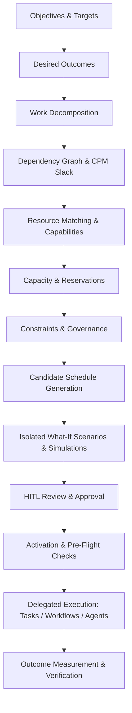

# STEP 44: AI Work Planning, Capacity & Resource Optimization Layer Architecture

## 1. Executive Overview

The **AI Work Planning, Capacity & Resource Optimization Layer** answers the fundamental operational question of the AI Work Layer platform:

> *"What work should happen, in what order, using which available resources, under which constraints, to achieve the desired outcomes?"*

This layer acts as an evidence-backed coordination and optimization framework connecting high-level organizational goals to realistic, verifiable execution schedules without introducing separate schedulers or execution engines.



### Core Invariants & Safety Mandates
1. **Advisory by Default**: Planning recommendations, decompositions, and candidate schedules remain strictly advisory until explicitly approved and activated by an authorized human operator.
2. **No Fabricated Data**: Capacity, availability, deadlines, costs, staffing, or business constraints are never synthesized. Unknown availability is explicitly modeled as `unknown`.
3. **Strict Human Privacy Boundaries**: Human capacity modeling is strictly opt-in and privacy-conscious. The system never infers working hours, personal calendars, habits, productivity, or health data.
4. **No Subjective Ranking**: No subjective employee productivity scores or arbitrary agent intelligence rankings are ever produced. Resource matching is explained strictly through factual capabilities, capacity limits, and policy compliance.
5. **No Second Engine**: The planning layer does not replace or duplicate existing task engines, workflow engines (STEP 23/24), agent runtimes (STEP 40), schedulers, or queues. It sequences and delegates work to existing systems.
6. **Precedence Hierarchy**:
   $$\text{System Security} \rightarrow \text{Governance (STEP 32)} \rightarrow \text{Tenant Isolation} \rightarrow \text{RBAC} \rightarrow \text{Safety / HITL (STEP 31)} \rightarrow \text{Hard Constraints} \rightarrow \text{Resource Limits} \rightarrow \text{Outcome Requirements} \rightarrow \text{Soft Preferences}$$
   Optimization algorithms never weaken or bypass a higher-order constraint to satisfy a lower-order preference.

---

## 2. Canonical Planning Lifecycle

The complete lifecycle from strategic intent to measured business impact:

1. **Strategic Intent**: An `Objective` (STEP 43) or desired `Outcome` is selected with measurable targets and deadlines.
2. **Work Decomposition**: Hybrid or deterministic planner identifies existing candidate work items (`tasks`, `workflows`, `agent_runs`, `milestones`, `approvals`, `simulations`).
3. **Dependency Graph Construction**: Graph directed edges (`finish_to_start`, `start_to_start`, `blocks`, etc.) are established. A strict DFS graph coloring check detects any cycles and Kahn's algorithm computes valid topological orders and Critical Path Method (CPM) slacks.
4. **Resource Matching**: Work items are matched against registered `WorkResource` records based on explicit capability declarations, execution policies, and workspace scopes.
5. **Capacity Analysis & Reservation Requests**: Available vs. reserved units (hours, runs, tokens, concurrency) are computed across the planning window. Proposed reservations are audited.
6. **Constraint Evaluation**: Hard constraints (deadlines, budgets, security classifications, mandatory approvals) and soft trade-offs are evaluated.
7. **Schedule Candidate Generation**: Multiple viable schedules (e.g. *Dependency-Optimized Baseline*, *Sequential Low-Concurrency*) are generated and compared along explicit, factual dimensions (duration, AI cost, human workload, risk flags).
8. **Isolated Scenario Simulation**: Planners test "What-if" scenarios (e.g., resource outage, budget reduction, deadline shift) with optional integration to the STEP 41 Simulation Engine without mutating production plans.
9. **Human Approval Gate**: Required HITL review validates assumptions, risks, and resource allocations. An approved plan freezes an immutable `WorkPlanVersion`.
10. **Plan Activation & Staleness Verification**: Pre-flight validation checks if resources, dependencies, budgets, or governance policies have drifted. If drift is detected, the plan is marked `stale` and activation is blocked until revalidated.
11. **Delegated Execution**: Execution is delegated directly to `TaskExecutionService`, `WorkflowExecutor`, `AgentRuntime`, and Job Queues.
12. **Outcome Verification**: Executed deliverables feed back into STEP 43 Outcome Intelligence for empirical attribution and verification.

---

## 3. Data Models & Schemas

The database schema is implemented in `040_planning.py` across 14 tables:

| Model | Table | Description |
|---|---|---|
| `WorkPlan` | `work_plans` | Header tracking workspace, objective, status (`draft`, `proposed`, `approved`, `active`, `paused`, `completed`, `cancelled`, `archived`), and planning mode (`manual`, `assisted`, `optimized`). |
| `WorkPlanVersion` | `work_plan_versions` | Immutable snapshot of items, dependencies, constraints, capacity, and candidate schedules. |
| `PlanningItem` | `planning_items` | Reference to existing system entities (`task`, `workflow`, `agent_run`, `agent_team_run`, `milestone`, `outcome`, `approval`, `evaluation`, `simulation`). Estimates are explicitly tagged. |
| `PlanningDependency` | `planning_dependencies` | Directed relationship with types (`finish_to_start`, `start_to_start`, `finish_to_finish`, `start_to_finish`, `blocks`, `requires`, `optional_after`) and lag duration. |
| `WorkResource` | `work_resources` | Polymorphic resource reference (`human`, `agent`, `agent_team`, `workflow`, `tool`, `connector`, `system`) with declared capabilities and availability policies. |
| `ResourceAvailability` | `resource_availability` | Explicit availability intervals with capacity units and source (`manual`, `calendar`, `system`, `policy`, `derived`). |
| `CapacitySnapshot` | `capacity_snapshots` | Point-in-time capacity measurement tracking available, reserved, allocated, and remaining units. |
| `CapacityReservation` | `capacity_reservations` | Scoped reservation of resource capacity linked to a planning item, subject to authorization and release policies. |
| `PlanningConstraint` | `planning_constraints` | Hard/soft constraint configuration across deadlines, budgets, capabilities, data access, and concurrency. |
| `ScheduleCandidate` | `schedule_candidates` | Deterministically generated candidate schedule with timeline allocations, constraint results, and factual trade-offs. |
| `PlanningBlocker` | `planning_blockers` | Operational impediment with type (`dependency`, `capacity`, `approval`, `security`, `deadline`), severity, and evidence citations. |
| `PlanningScenario` | `planning_scenarios` | Isolated sandbox for "What-If" parameter variations and simulation runs. |
| `PlanningRecommendation` | `planning_recommendations` | Evidence-backed advisory suggestions (e.g. sequence changes, alternative agent assignments). |
| `PlanStalenessRecord` | `plan_staleness_records` | Audit log of detected state drift triggering revalidation requirements. |

---

## 4. Subsystem Components

### 4.1 Dependency Graph Engine (`dependency_graph.py`)
- **Cycle Detection**: Employs a 3-color DFS algorithm ($0=\text{unvisited}, 1=\text{visiting}, 2=\text{visited}$). If a back-edge is encountered, the exact cycle path is extracted and raises `DependencyCycleError`.
- **Topological Ordering**: Implements Kahn's algorithm using in-degree tracking to provide deterministic execution order.
- **Critical Path Method (CPM)**: Computes Early Start ($ES$), Early Finish ($EF$), Late Start ($LS$), Late Finish ($LF$), and Total Float/Slack ($LS - ES$). Items with zero float are flagged as the critical path.

### 4.2 Resource Matcher (`resources.py`)
- Matches requested capabilities (e.g. `python`, `document_analysis`, `security_review`) against resources with status `active`.
- Evaluates concurrency bounds (e.g. agent maximum concurrent runs) and tenant isolation rules.
- Generates transparent, factual explanations for matches (e.g. `"Agent SecurityAuditor matches because it has capability 'security_review' and active status."`).

### 4.3 Capacity & Reservation Manager (`capacity.py`)
- Aggregates available intervals and subtracts active reservations to determine remaining capacity.
- Handles unknown availability honestly without synthesizing working hours.
- Evaluates reservation requests against authorization policies; rejects unauthorized locks.
- Projects capacity forecasts labeled explicitly with `is_forecast: true`.

### 4.4 Constraint Engine (`constraints.py`)
- **Hard Constraints**: Evaluates non-negotiable boundaries (deadlines, budgets, mandatory approvals, security boundaries). Any violation triggers an immediate rejection or blocks candidate generation.
- **Soft Constraints**: Tracks trade-offs and logs warnings without silently invalidating safety rules.

### 4.5 Schedule Generation & Multi-Candidate Optimizer (`scheduler.py`, `optimizer.py`)
- Produces distinct schedule candidates without applying an opaque single score.
- Performs factual multi-dimensional comparison:
  - Duration (hours/days)
  - Estimated AI / tool costs
  - Human workload vs. AI workload
  - Deadline compliance margin
  - Bottleneck risks and dependency complexity

### 4.6 What-If Scenario Sandbox (`scenarios.py`)
- Clones plan versions into an isolated in-memory workspace.
- Applies scenario parameter overrides (e.g., `"agent_unavailable"`, `"deadline_shortened"`, `"budget_cut"`).
- Re-runs dependency and capacity validation to measure impact before touching production.
- Optionally integrates with STEP 41 Simulation Engine.

### 4.7 Plan Lifecycle & Staleness Verification (`lifecycle.py`)
- Enforces strict transition rules: `draft -> proposed -> approved -> active -> completed / paused / cancelled`.
- Pre-flight activation verifies:
  1. Immutable version lock.
  2. No active blockers.
  3. No dependency cycle.
  4. Capacity reservations verified.
  5. State drift detection (detects if any underlying task was modified externally).
  6. Governance policy re-check.

---

## 5. Security, Governance & Privacy Safeguards

1. **Planner Cannot Grant Authorization**: Declaring a resource capability or selecting an agent in a plan does not grant runtime permissions. Runtime execution remains governed by RBAC and STEP 32 Governance policies.
2. **Human Privacy Protection**: Working hours are sourced strictly from explicit manual declarations or published calendar feeds. The engine forbids inferences regarding health, personal habits, or location.
3. **No Autonomous External Commitments**: Plans cannot trigger external writes, cloud provisioning, or vendor purchases without passing through HITL verification.
4. **Tenant Isolation**: All queries enforce strict workspace tenant filtering. Cross-tenant planning references are rejected with `PlanningTenantViolationError`.
5. **No Subjective Ranking**: Prohibits sorting or scoring human workers based on subjective productivity metrics.

---

## 6. Integration Points

- **Step 24 Durable Job Queue**: Long-running planning tasks (`planning_generation`, `planning_validation`, `capacity_refresh`, `capacity_forecast`, `planning_scenario`, `plan_staleness_check`, `planning_recommendation`) are processed asynchronously via `PlanningJobHandler`.
- **Step 26 Event Bus**: Emits 19 auditable domain events (`work_plan.created`, `work_plan.activated`, `capacity.updated`, `planning.conflict_detected`, etc.) with correlation IDs.
- **Step 32 Governance**: Controls resource assignment visibility, budget ceilings, and activation authorization.
- **Step 33 Data Governance**: Classifies planning schedules and availability metadata; enforces retention and redaction policies.
- **Step 34 Security Operations**: Audits suspicious reservation patterns and attempted permission escalation.
- **Step 40 Agent Runtime**: Respects agent concurrency limits, step quotas, and model execution policies.
- **Step 41 Simulation Engine**: Runs synthetic stress tests against schedule candidates.
- **Step 42 Learning Layer**: Feeds historical execution overruns and tool failure rates into effort estimators.
- **Step 43 Outcome Intelligence**: Links planning items to objective targets and measures final delivery.

---

## 7. API Reference

### Public API (`/api/v1/`)
- `POST /api/v1/work-plans` - Create a work plan
- `GET /api/v1/work-plans` - List plans in workspace
- `GET /api/v1/work-plans/{plan_id}` - Retrieve plan details
- `PATCH /api/v1/work-plans/{plan_id}` - Update plan metadata
- `POST /api/v1/work-plans/{plan_id}/versions` - Create a new plan version
- `GET /api/v1/work-plans/{plan_id}/versions` - List plan version history
- `POST /api/v1/work-plans/{plan_id}/plan` - Generate candidate schedules
- `POST /api/v1/work-plans/{plan_id}/validate` - Validate plan constraints & cycles
- `POST /api/v1/work-plans/{plan_id}/activate` - Perform pre-flight checks and activate
- `POST /api/v1/work-plans/{plan_id}/pause` - Pause an active plan
- `GET /api/v1/work-plans/{plan_id}/dependencies` - Get dependency graph & critical path
- `GET /api/v1/work-plans/{plan_id}/resources` - Get resource allocations & matches
- `GET /api/v1/work-plans/{plan_id}/conflicts` - Get detected scheduling conflicts
- `GET /api/v1/work-plans/{plan_id}/blockers` - Get active impediments
- `POST /api/v1/planning-scenarios` - Create a what-if scenario
- `GET /api/v1/planning-scenarios/{scenario_id}` - Retrieve scenario details
- `POST /api/v1/planning-scenarios/{scenario_id}/run` - Execute scenario simulation
- `GET /api/v1/resources` - List workspace resources
- `GET /api/v1/resources/{resource_id}` - Get resource details
- `GET /api/v1/resources/{resource_id}/capacity` - Get resource capacity window
- `POST /api/v1/capacity-reservations` - Request a capacity reservation
- `GET /api/v1/capacity-reservations` - List active reservations
- `GET /api/v1/planning/recommendations` - List planning recommendations
- `GET /api/v1/planning/forecast` - Retrieve labeled capacity forecast
- `GET /api/v1/planning/workload` - Retrieve multi-dimensional workload snapshot

---

## 8. Client SDKs

### JavaScript SDK
```javascript
import { AIWorkLayerClient } from '@ai-work-layer/sdk';

const client = new AIWorkLayerClient({ apiKey: '...', workspaceId: 'ws-123' });

// Create and generate a work plan
const plan = await client.workPlans.create({
  name: 'Q3 Analytics Platform Upgrade',
  objective_id: 'obj-456',
  planning_mode: 'assisted'
});

const candidates = await client.workPlans.generate(plan.id, {
  objective_id: 'obj-456',
  items: [...],
  dependencies: [...]
});

// Compare and activate
const validation = await client.workPlans.validate(plan.id, plan.version_id);
if (validation.is_valid) {
  await client.workPlans.activate(plan.id, { version_id: plan.version_id });
}
```

### Python SDK
```python
from ai_work_layer import AIWorkLayerClient

client = AIWorkLayerClient(api_key="...", workspace_id="ws-123")

# Run an isolated What-If scenario
scenario = client.planning_scenarios.create({
    "name": "Simulate Agent Outage",
    "base_plan_version_id": "ver-789",
    "overrides": {"removed_resources": ["res-agent-1"]}
})
results = client.planning_scenarios.run(scenario["id"])
print(f"Scenario duration delta: {results['results']['delta_duration_hours']}h")
```
